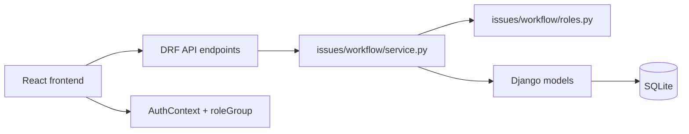

# Student Issue Management System: Compiled Documentation

This document consolidates the current repository documentation into a single downloadable reference for the project as it exists in the codebase today.

---

# 1. Project Overview

## Current system snapshot

This repository now implements a workflow-driven academic issue-routing system rather than a generic issue tracker with a simpler category-to-department assignment. The backend owns the routing decisions; the frontend presents the current role-aware views and dashboards but does not determine workflow behaviour.

The current implementation includes:

- Django REST API with Django auth, JWT, and custom profile roles
- 12 canonical issue categories and a workflow engine in `backend/issues/workflow/`
- Role-aware issue assignment and forwarding using workflow definitions
- Issue document requirements and completeness checking
- Issue activity/audit trails
- ML category prediction during issue creation, without persisting prediction confidence/metadata
- React + TypeScript frontend with student, staff, and admin route groups
- A single reusable staff dashboard driven by the authenticated user's real role

## Tech stack

- Python / Django / Django REST Framework
- SQLite for the current local database
- SimpleJWT for token-based auth
- React + TypeScript + Vite
- React Router for route protection and role-group routing

## Current architecture in one sentence

The system evolved from a generic issue-management concept into a role-based academic workflow engine where issue categories map to workflow definitions, each workflow has a starting role and fixed or dynamic forwarding rules, and the backend resolves the next officer by role and, where needed, by the student’s own department.

## Repository truth: current backend responsibilities

### Backend apps and real responsibilities

- `backend/accounts`: `UserProfile`, auth-related serializers, role constants, and staff directory logic
- `backend/issues`: issues, documents, workflow engine, serializers, views, and issue activity
- `backend/categories`: category catalogue and required-document relationships
- `backend/departments`: department model and admin metadata, but not the live workflow-routing authority
- `backend/ml`: ML classifier and model configuration
- `backend/student_issue_system`: project URL routing

### Real issue workflow model

Issues are created without a direct department-based assignment. Instead:

1. the issue is created with a `Category`
2. the workflow engine resolves the category’s `starting_role`
3. it finds a suitable officer via `find_officer_for_role()`
4. it logs the assignment via `IssueActivity`
5. issue status and workflow actions proceed through the category-specific route

This means the real assignment logic is backend-driven in `backend/issues/workflow/service.py` and `backend/issues/workflow/roles.py`, not in the frontend.

## Current role system

The system currently includes these real role values:

- `student`
- `course_adviser`
- `hod`
- `department_admin`
- `dept_exam_officer`
- `lecturer`
- `ict_officer`
- `exams_officer`
- `registry`
- `bursary`
- `school_admin_office`
- `student_affairs_officer`
- `admin`

Frontend route groups collapse these into three broad groups:

- `student`: student routes and dashboard
- `staff`: all non-student, non-admin roles share the staff route group
- `admin`: admin routes and dashboard

This is not the same as the real backend role values. The staff dashboard reads the actual `UserProfile.role` and applies a role-specific configuration to display the relevant workload.

## Current workflow engine

The current canonical workflow categories are:

- Missing Result
- Grade Dispute
- Course Registration
- Transcript Request
- School Fees Issue
- Academic Clearance
- Admission Issue
- Certificate Collection
- Examination Issue
- Portal/System Issue
- Student Welfare
- Other

These are backed by `WORKFLOW_DEFINITIONS` in `backend/issues/workflow/definitions.py`.

Role routing is split into:

- `CENTRAL_ROLES`: roles looked up institution-wide
- `DEPARTMENT_SCOPED_ROLES`: roles looked up against the student’s own `UserProfile.department_name`

Important routing facts:

- `starting_role` is the first role for each category
- `forward_chain` defines the fixed forward path for most categories
- `backward_transitions` define send-back behaviour
- `final_authority_roles` define who may resolve the issue
- `Other` is the only dynamic-forward category; the HOD decides the target role at runtime
- `assigned_to` is only left null during the initial assignment exception path when the workflow cannot resolve a starting officer
- forwarding and send-back do not intentionally clear `assigned_to`; they raise if the target officer cannot be resolved

## Document requirement and completeness logic

Document requirements are attached to categories via the `Category.documents` many-to-many field. The document service checks the issue’s required documents against uploaded `IssueDocument` rows and calculates:

- `is_complete`
- `missing_documents`
- transition to `ready_for_review` when the issue was previously `pending` and all required documents are now present

This is implemented in `backend/issues/services/document_service.py` and the `Issue` model in `backend/issues/models.py`.

## Issue activity/audit trail

`IssueActivity` records issue events, including:

- `Issue Created`
- `Automatically Assigned`
- `Issue Manually Assigned`
- `Document Uploaded`
- `Issue Review Started`
- `Issue Ready For Review`
- `Issue Forwarded`
- `Issue Sent Back`
- `Issue Resolved`
- `Issue Closed`
- other workflow-specific actions created by the engine

`is_system_action` distinguishes system-generated actions from user-triggered actions.

## Authentication and roles

The current app uses Django auth with a custom `UserProfile` linked 1:1 to the Django user.

Current auth flow in the repo:

- Student registration: `POST /api/accounts/register/`
- Staff creation: `POST /api/accounts/staff/`
- Login: `POST /api/accounts/login/`
- Token endpoints: `/api/token/` and `/api/token/refresh/` still exist in the Django project, but the application’s login flow is email-based via `EmailLoginView`
- `must_change_password` is stored on the profile and enforced by the frontend route guard until a password change is completed

## Frontend architecture

The frontend is React + TypeScript + Vite with role-group route protection.

Key structure:

- `frontend/src/App.tsx`: route tree and role-group gates
- `frontend/src/routes/ProtectedRoute.tsx`: authentication and role-group checks
- `frontend/src/components/layout/AppShell.tsx`: shell with sidebar and topbar
- `frontend/src/components/layout/Sidebar.tsx`: `NAV_BY_ROLE` for student/staff/admin
- `frontend/src/components/layout/Topbar.tsx`: top navigation and user info
- `frontend/src/pages/student/Dashboard.tsx`: student dashboard
- `frontend/src/pages/staff/Dashboard.tsx`: reusable role-aware staff dashboard
- `frontend/src/pages/admin/Dashboard.tsx`: admin overview with unassigned-by-role view
- `frontend/src/pages/reports/Reports.tsx`: shared reports view

The staff dashboard is intentionally not 11 duplicated components. It reads the actual user role and applies a configuration mirror from `frontend/src/lib/roleWorkloadConfig.ts`.

## Staff dashboard redesign

The implemented redesign is a single reusable staff dashboard that:

- reads the authenticated user’s real role
- identifies the workload relevant to that role
- filters assigned issues by the user’s email
- limits the visible category set using the frontend config
- displays role-specific workload information without having 11 separate screen components

The config is a projection of the backend workflow definitions and is intentionally not treated as the backend source of truth. It must stay synchronized with `issues/workflow/definitions.py` because there is no dedicated “categories by role” API endpoint.

## Admin dashboard changes

The admin dashboard includes an “Unassigned Issues by Role” section. It works by combining:

- `GET /api/issues/?unassigned=true`
- `GET /api/accounts/staff/directory/`
- `CATEGORY_STARTING_ROLE` from `frontend/src/lib/roleWorkloadConfig.ts`

This lets the frontend explain which workflow role should have received an unassigned issue, and whether staff exist for that role. The dashboard does not assign officers or route issues; it only displays the workflow state.

## Department architecture today

The current `Department` model exists, but it is not the live routing authority.

The actual routing logic uses `UserProfile.department_name` and role resolution, not `Department.assigned_officer` or `Category.department`.

The database-backed department catalogue has operational units such as:

- Bursary Office
- Department of Computer Science
- Exams and Records Unit
- ICT Unit
- Registry
- School Admin Office
- Student Affairs Office

This is different from the earlier generic mock department catalogue. The project moved away from treating old mock departments as authoritative routing data.

## ML classification status

The current ML implementation is real but limited:

- category prediction is used during issue creation
- high-confidence predictions can create the issue immediately
- medium-confidence predictions require confirmation
- low-confidence predictions require manual category selection
- the prediction is not persisted on the issue model as confidence, category source, or classification metadata
- no ML metrics endpoint is currently implemented from real persisted data

This must be distinguished from future ML analytics work.

## Backend/frontend data boundaries

The current data boundaries are important:

- Workflow routing and assignment are backend-driven.
- Frontend dashboards fetch issue data and do some client-side filtering and aggregation.
- The issue list endpoint returns a broad set of issues; there is no dedicated dashboard aggregation endpoint.
- The staff directory endpoint provides role availability data.
- Some admin and user dashboard statistics are computed client-side from these returned records.

This is workable for the repository’s current scale, but it is not a backend analytics system and it does not replace the workflow engine.

## Current scope and deferred work

### Implemented

- workflow-driven issue lifetime
- category-based required documents
- role-aware workflow routing and assignment
- issue activity logging
- role-aware staff dashboard redesign
- admin unassigned-by-role overview
- document completeness and ready-for-review transition

### Partially implemented

- department architecture and department data sources are still inconsistent between the model and the actual workflow lookup logic
- some dashboard statistics remain derived client-side from broad issue-fetch patterns

### Deferred / not implemented

- 11 separate staff dashboard components
- new backend dashboard statistics endpoints just for charts
- `can_resolve` enhancement on the issue serializer
- ML analytics metrics that require persisted classification metadata
- mock dashboard metrics presented as real data

## Architecture decisions / development pivots

The repo shows several real decisions that matter:

- moved away from generic mock department data as the routing authority
- introduced workflow-driven assignment in the backend
- introduced role-aware staff dashboards
- reused one parametrized staff dashboard instead of 11 duplicated dashboards
- kept workflow authority on the backend, not the frontend
- avoided creating unnecessary new dashboard endpoints for simple client-side calculations
- deferred ML analytics until classification metadata can be persisted
- skipped the optional `can_resolve` backend enhancement

## Documentation note

This README reflects the implementation that exists in the repository today. Older documentation that described a simpler department-based or mock-driven architecture is not treated as authoritative unless it matches the current code.

---

# 2. Architecture Overview

This document reflects the current implementation in the repository as of the current branch state. It explicitly documents the architectural pivot from a generic student issue tracker to a workflow-driven academic routing system.

## 1. Current system architecture

The project is a Django backend plus a React/TypeScript frontend. The real authority for issue lifecycle decisions lives in the backend workflow engine, not in the frontend.

### Architectural layers

- Backend API layer: Django REST Framework viewsets/APIViews under `backend/issues`, `backend/accounts`, `backend/categories`, and `backend/departments`
- Business logic layer: workflow service, issue service, document service, and ML prediction entry points
- Domain layer: `Issue`, `IssueDocument`, `IssueActivity`, `Category`, `Department`, `UserProfile`, and related metadata
- Presentation layer: React frontend under `frontend/src` with route protection and role-aware dashboards

## 2. Backend app responsibilities

| App | Current responsibility |
| --- | --- |
| `accounts` | `UserProfile`, role constants, auth endpoints, staff directory, password-change flow |
| `issues` | issue creation, list/detail, workflow actions, document handling, status transition rules |
| `categories` | categories and required-document relationships |
| `departments` | department model and admin metadata; not the live routing authority |
| `documents_app` | document catalog entries used by issue documents |
| `ml` | ML classifier, model config, and prediction logic |
| `student_issue_system` | project-wide URL configuration |

## 3. Major architectural pivot

The repository has moved away from a simple generic issue tracker to a workflow-driven academic issue routing system.

The key distinction is:

- issue category: the type of issue, e.g. Missing Result, Grade Dispute, Portal/System Issue
- workflow definition: the role chain for a category, declared in `WORKFLOW_DEFINITIONS`
- starting role: the first role assigned for that category
- department-scoped roles: roles resolved against the student’s academic department (`UserProfile.department_name`)
- central roles: roles resolved institution-wide
- automatic assignment: done by the backend workflow engine
- workflow forwarding: done by the backend and validated against the category’s definition
- send-back behaviour: backend-defined transitions using `backward_transitions`
- final resolution authority: declared in `final_authority_roles`

The frontend is not the source of truth for workflow behaviour. The backend workflow engine decides issue routing, assignment, and approval authority.

## 4. Current role model

The actual backend role values are:

- `student`
- `course_adviser`
- `hod`
- `department_admin`
- `dept_exam_officer`
- `lecturer`
- `ict_officer`
- `exams_officer`
- `registry`
- `bursary`
- `school_admin_office`
- `student_affairs_officer`
- `admin`

The frontend collapses these into route groups:

- `student`
- `staff`
- `admin`

This route-level grouping is separate from the real backend `UserProfile.role` values used throughout the application.

## 5. Current workflow engine

The workflow engine in `backend/issues/workflow/service.py` is the single authority for issue moves such as:

- `perform_initial_assignment()`
- `start_review()`
- `forward_issue()`
- `send_back_issue()`
- `request_more_information()`
- `resolve_issue()`
- `confirm_resolution()`
- `reject_resolution()`
- `manual_assign_officer()`

The category-to-workflow mapping lives in `backend/issues/workflow/definitions.py`. The workflow definitions include:

| Category | Starting role | Fixed flow | Final authority |
| --- | --- | --- | --- |
| Missing Result | Course Adviser | Course Adviser → Department Admin → HOD → Exams Officer | Course Adviser, Exams Officer |
| Grade Dispute | Course Adviser | Course Adviser → Lecturer | Course Adviser |
| Course Registration | Course Adviser | Course Adviser → Exams Officer | Course Adviser |
| Transcript Request | Department Admin | Department Admin → HOD → Exams Officer | Exams Officer |
| School Fees Issue | Bursary | Bursary | Bursary |
| Academic Clearance | Department Admin | Department Admin → HOD | Department Admin |
| Admission Issue | School Admin Office | School Admin Office | School Admin Office |
| Certificate Collection | Registry | Registry → Bursary | Bursary |
| Examination Issue | Department Examination Officer | Department Examination Officer → HOD → Exams Officer | Department Examination Officer, Exams Officer |
| Portal/System Issue | ICT Officer | ICT Officer | ICT Officer |
| Student Welfare | Student Affairs Officer | Student Affairs Officer | Student Affairs Officer |
| Other | HOD | Dynamic | HOD |

The workflow engine also explicitly distinguishes department-scoped and central roles. Department-scoped roles are resolved against the issue owner’s own academic department; central roles are resolved institution-wide.

## 6. Issue statuses and lifecycle

The current status graph is fixed and explicitly enforced in `backend/issues/workflow/service.py`:

- `pending` → `ready_for_review`
- `ready_for_review` → `in_progress`
- `in_progress` → `ready_for_review` or `pending` or `resolved`
- `resolved` → `closed` or `pending`
- `closed` → no further ordinary workflow transitions

This is not a generic status model with free-form transitions; the backend rejects invalid transitions.

## 7. Document requirements and completeness

Category-level required documents are stored as a many-to-many relation from `Category` to `Document`.

When an issue is created, the issue service obtains the category’s required documents. The upload flow creates `IssueDocument` rows and recalculates completeness:

- missing documents list is built from required docs not yet uploaded
- `Issue.is_complete` is set to `True` only when the required list is fully satisfied
- if the issue was pending and is now complete, it is automatically moved to `ready_for_review`

This is implemented in `backend/issues/services/document_service.py` and is tied to `IssueActivity` entries for document uploads and review readiness.

## 8. Issue activity and audit trail

`IssueActivity` is a first-class model in `backend/issues/models.py` with fields for:

- issue reference
- action string
- performed_by user
- system-action flag
- notes
- timestamp

This is the project’s audit trail. It is used for actions such as issue creation, automatic assignment, manual assignment, review start, forwarding, send-back, resolution, and document uploads. System events are distinguished by `is_system_action=True`.

## 9. Authentication and user profiles

Authentication is Django-based, with a custom `UserProfile` model and custom serializers for login and staff creation.

Notable details:

- `UserProfile.role` is the real role field used throughout the app
- `UserProfile.department_name` is a free-text field used by current department-scoped role lookup
- `must_change_password` is stored on the profile and enforced by the frontend route guard
- the app login flow uses the email-based `EmailLoginView`, while the underlying SimpleJWT endpoints remain available in the project

## 10. Department architecture and routing reality

The `Department` model exists and has fields for:

- `name`
- `description`
- `kind` (`academic` or `administrative`)
- `assigned_officer`

However, the live workflow routing does not use `Department.assigned_officer` or `Category.department` to determine issue assignment. The route resolution is driven by `UserProfile.role` and the student’s department in `issues/workflow/roles.py`.

The department model is therefore not the source of truth for workflow routing. It is metadata and administrative structure, not the engine that chooses officers.

## 11. Frontend architecture

The frontend is a React application with the following current structure:

- `frontend/src/App.tsx`: top-level routes
- `frontend/src/routes/ProtectedRoute.tsx`: auth and role-group guard logic
- `frontend/src/components/layout/AppShell.tsx`: shell wrapper
- `frontend/src/components/layout/Sidebar.tsx`: role-group nav
- `frontend/src/components/layout/Topbar.tsx`: header/dashboard navigation
- `frontend/src/pages/student/Dashboard.tsx`: student-specific dashboard
- `frontend/src/pages/staff/Dashboard.tsx`: reusable staff dashboard
- `frontend/src/pages/admin/Dashboard.tsx`: admin overview dashboard
- `frontend/src/pages/reports/Reports.tsx`: shared charts and reports

The route groups are coarse-grained; the staff dashboard is still a single route but internally role-aware.

## 12. Role-aware staff dashboard design

The implemented staff dashboard redesign is a single component that reads the authenticated user’s actual role and then chooses role-specific, workflow-based workload information. It does not fabricate 11 separate dashboard screens.

The config used by the dashboard lives in:

- `frontend/src/lib/roleWorkloadConfig.ts`

This file is a frontend mirror of the workflow definitions and is used to determine:

- display title
- relevant categories for a role
- empty-state wording for the dashboard

The mirror is intentionally not the system’s backend source of truth. It must remain synchronized with `backend/issues/workflow/definitions.py` because there is no API endpoint that returns “categories by role” today.

## 13. Admin dashboard details

The admin dashboard currently contains a role coverage overview and an unassigned-by-role summary. It works by combining:

- `GET /api/issues/?unassigned=true`
- `GET /api/accounts/staff/directory/`
- the role/category mapping in `CATEGORY_STARTING_ROLE`

This is a presentation layer for workflow state. The backend still decides assignment and routing.

## 14. Backend/frontend data boundaries

The current split is:

- backend-owned: workflow route logic, assignment, authorization, issue status, issue activity, required-document logic
- frontend-owned: dashboard filtering, client-side aggregation, role-specific presentation, issue list filtering by current user

There is no dedicated backend dashboard aggregation API. The existing issue list endpoint is broad, and the dashboards derive their counts locally from that data. This is a practical current arrangement but it is not a high-scale analytics system.

## 15. ML classification status

The ML implementation is active in the creation flow:

- issue creation can call `predict_issue()`
- high-confidence predictions can create the issue immediately
- medium-confidence predictions ask for confirmation
- low-confidence predictions require manual selection

However, the repository does not currently persist classification confidence, prediction source, or outcome metadata onto the issue. That means ML metrics are not currently backed by stored data and should not be presented as implemented analytics.

## 16. Current scope and deferred work

### Implemented

- workflow-driven issue routing
- role-aware staff dashboard
- admin unassigned-by-role overview
- document completeness logic
- activity tracking

### Partially implemented

- department architecture still has a mismatch between the model and the actual workflow lookup mechanism
- some dashboard numbers are still derived client-side from broad issue data

### Deferred / not implemented

- dedicated categories-by-role API endpoint
- per-issue `can_resolve` serializer enhancement
- ML analytics dashboards backed by persisted prediction metadata
- 11 distinct staff dashboard components
- unnecessary backend dashboard aggregation endpoints for current front-end needs

## 17. Summary

The repository now reflects a functional workflow-driven academic issue system rather than a static generic issue tracker. The backend is the authority for routing and assignment; the frontend is a role-aware presentation layer over that backend system. Department and workflow architecture are real but they are not identical: the model contains a department structure, but the live issue-routing logic is driven by role definitions and the student’s department context, not by a direct department assignment chain.

---

# 3. Workflow Reference

This document reflects the workflow actually implemented in the repository today. The current system is not based on a category’s owning department alone; it is driven by the backend workflow engine in `backend/issues/workflow/definitions.py` and `backend/issues/workflow/service.py`.

## 1. Canonical workflow categories

The project currently defines the following 12 canonical issue categories:

- Missing Result
- Grade Dispute
- Course Registration
- Transcript Request
- School Fees Issue
- Academic Clearance
- Admission Issue
- Certificate Collection
- Examination Issue
- Portal/System Issue
- Student Welfare
- Other

These names are the ones used by both the workflow engine and the category alignment migration.

## 2. Status model and transitions

The actual status choices on `Issue` are:

- `pending`
- `ready_for_review`
- `in_progress`
- `resolved`
- `closed`

The backend enforces this transition graph:

| Current status | Allowed next statuses |
| --- | --- |
| `pending` | `ready_for_review` |
| `ready_for_review` | `in_progress` |
| `in_progress` | `ready_for_review`, `pending`, `resolved` |
| `resolved` | `closed`, `pending` |
| `closed` | none |

Invalid transitions are rejected by the workflow engine.

## 3. Workflow engine architecture

The workflow engine is declarative. A category does not have custom logic written in an if/else chain; it has a `WorkflowDefinition` object with:

- `starting_role`
- `forward_chain`
- `backward_transitions`
- `final_authority_roles`
- `required_documents`
- `dynamic_forward` (used for `Other`)

The engine resolves the next or previous officer using `find_officer_for_role()`, which uses:

- central-role lookup for institution-wide roles
- department-scoped lookup for academic department roles

The key point is that workflow behaviour is backend-owned and follows the category definition, not a collection of frontend rules.

## 4. Category-to-workflow summary

| Category | Starting role | Fixed flow | Final authority |
| --- | --- | --- | --- |
| Missing Result | Course Adviser | Course Adviser → Department Admin → HOD → Exams Officer | Course Adviser, Exams Officer |
| Grade Dispute | Course Adviser | Course Adviser → Lecturer | Course Adviser |
| Course Registration | Course Adviser | Course Adviser → Exams Officer | Course Adviser |
| Transcript Request | Department Admin | Department Admin → HOD → Exams Officer | Exams Officer |
| School Fees Issue | Bursary | Bursary | Bursary |
| Academic Clearance | Department Admin | Department Admin → HOD | Department Admin |
| Admission Issue | School Admin Office | School Admin Office | School Admin Office |
| Certificate Collection | Registry | Registry → Bursary | Bursary |
| Examination Issue | Department Examination Officer | Department Examination Officer → HOD → Exams Officer | Department Examination Officer, Exams Officer |
| Portal/System Issue | ICT Officer | ICT Officer | ICT Officer |
| Student Welfare | Student Affairs Officer | Student Affairs Officer | Student Affairs Officer |
| Other | HOD | Dynamic forward | HOD |

## 5. Assignment and routing rules

### Initial assignment

`perform_initial_assignment()` resolves the category’s `starting_role` and assigns the issue to an available officer if one exists. If no officer is available, the issue is created and left with `assigned_to = null`, and a system `IssueActivity` log explains why.

This is the only place where the issue is intentionally left unassigned in the normal workflow.

### Forwarding

`forward_issue()` reassigns the issue to the next role in the category’s fixed chain, or to a manually chosen `target_role` when the category is `Other`.

### Send-back

`send_back_issue()` moves the issue to a prior role via the category’s `backward_transitions` map.

### Final resolution

Only roles in the category’s `final_authority_roles` may resolve an issue. This is enforced in the backend.

## 6. Department-scoped vs central routing

The workflow engine distinguishes:

- `CENTRAL_ROLES`: institution-wide roles looked up without department scoping
- `DEPARTMENT_SCOPED_ROLES`: roles resolved against the issue’s student department

Examples:

- Central: ICT Officer, Exams Officer, Registry, Bursary, School Administration Office, Student Affairs Officer
- Department-scoped: Course Adviser, HOD, Department Admin, Department Examination Officer, Lecturer

The key implementation is in `backend/issues/workflow/roles.py` and not in the frontend.

## 7. Document flow

The document lifecycle is:

1. issue created with required documents determined by category
2. student uploads the required files
3. `check_issue_completeness()` compares required document names to uploaded `IssueDocument` rows
4. when all required documents are uploaded and the issue is pending, it is moved to `ready_for_review`
5. the workflow may then start with the assigned officer

This is currently the actual implementation in `backend/issues/services/document_service.py`.

## 8. Workflow action endpoints

These endpoints are active in the repository:

- `GET /api/issues/`
- `POST /api/issues/create/`
- `POST /api/issues/<id>/upload-document/`
- `POST /api/issues/<id>/start/`
- `POST /api/issues/<id>/forward/`
- `POST /api/issues/<id>/send-back/`
- `POST /api/issues/<id>/request-info/`
- `POST /api/issues/<id>/resolve/`
- `POST /api/issues/<id>/confirm/`
- `POST /api/issues/<id>/reject/`
- `POST /api/issues/<id>/assign/`

These actions are the real workflow API surface and are more accurate than the older generic status-only design.

## 9. Activity examples currently generated by the backend

The workflow engine creates entries such as:

- `Issue Created`
- `Automatically Assigned`
- `Issue Manually Assigned`
- `Document Uploaded`
- `Issue Review Started`
- `Issue Ready For Review`
- `Issue Forwarded`
- `Issue Sent Back`
- `Issue Resolved`
- `Issue Closed`

The precise strings are not abstract placeholders; they are the actual action values written by the service code.

## 10. Important limitations

- The frontend uses `roleWorkloadConfig.ts` as a display mirror of backend workflow definitions, not as a backend source of truth.
- The `Department` model is not the live workflow routing authority.
- Department-scoped role lookup depends on `UserProfile.department_name`, which is a free-text field in the current implementation.
- There is no categories-by-role API endpoint; the frontend config is manually synchronized with the backend model.
- The issue list endpoint does not perform role-aware system aggregation; it is a broad fetch that dashboards filter client-side.

## 11. Current workflow summary

The actual operational flow is:

1. student creates an issue
2. backend predicts or resolves the category
3. backend runs the category’s workflow definition
4. backend assigns the issue to the starting role if an officer exists
5. student uploads required documents
6. issue becomes `ready_for_review` when complete
7. officer starts review and proceeds through the category workflow
8. the issue is forwarded, sent back, or resolved according to the backend workflow definition
9. student confirms or rejects the resolution as the final step before closure

---

# 4. Department Architecture Review

This document reflects the department architecture currently implemented in the repository, not an ideal future state.

## Current model

The current `Department` model is defined in `backend/departments/models.py` and contains:

- `name` (`CharField`, unique)
- `description` (`TextField`, optional)
- `kind` (`academic` or `administrative`)
- `assigned_officer` (`ForeignKey(User)`, nullable, optional)

This model exists, but it is not the live routing authority for issue assignment.

## How departments are used today

### `Category.department`

`Category.department` is a real `ForeignKey` to `Department`. It is used as informational metadata and is displayed alongside categories. It is not used by the workflow engine to determine who should receive an issue.

### `Department.assigned_officer`

`Department.assigned_officer` exists in the schema, but the workflow engine does not read it. The current backend assignment logic is based on role resolution, not on a one-officer-per-department assumption.

### `UserProfile.department_name`

This is the field that actually matters for department-scoped routing. In `backend/accounts/models.py`, students and staff are assigned a free-text `department_name`. The workflow resolver uses this field for roles such as:

- `course_adviser`
- `hod`
- `department_admin`
- `dept_exam_officer`
- `lecturer`

The backend does not use `Category.department` for that lookup.

## Why this matters

The system moved away from a legacy department-driven assignment model. The live routing logic is structured around role workflow definitions, and the department-scoped roles are matched against the issue’s student’s academic department through `UserProfile.department_name`.

This means the real architecture is:

- category defines the workflow
- workflow defines starting role and forwarding path
- role resolution chooses the actual officer
- department-scoped roles additionally consider the student’s own department

The `Department` table is not the source of truth for workflow routing.

## Current department data architecture

The database-backed department catalogue contains workflow-oriented operational units such as:

- Bursary Office
- Department of Computer Science
- Exams and Records Unit
- ICT Unit
- Registry
- School Admin Office
- Student Affairs Office

This is not the older mock department catalogue. The project has already moved to a more operational department architecture and seeded the canonical categories accordingly.

## Relationship between academic departments and operational departments

There is a meaningful distinction in the current implementation:

- `Category.department` is a category’s administrative owner or operational association
- `UserProfile.department_name` is the person’s actual academic department or department affiliation
- role routing uses the latter for department-scoped roles

The project therefore does not treat the legacy mock “department catalogue” as the authoritative workflow structure.

## Key current limitations

### 1. `UserProfile.department_name` is a string field

This makes department-scoped routing dependent on exact text matching, which is weaker than a foreign-key-backed department reference.

### 2. The model and workflow logic are not fully aligned

The `Department` model and the live workflow routing do not share the same source of truth. The backend route logic is role-driven and not unquestionably coupled to the `Department` table.

### 3. The frontend cannot always prove department-specific availability

The admin dashboard’s “Unassigned Issues by Role” feature can determine system-wide role coverage using `GET /api/accounts/staff/directory/`, but it cannot always determine whether a specific department-scoped role is available inside that student’s department because the issue list shape does not expose the department context required for that exact check.

## Current status

The project’s department architecture is currently in a hybrid state:

- the `Department` model exists and is used as metadata and category ownership
- role-based workflow routing is the actual runtime authority
- the route logic still depends on `UserProfile.department_name`
- there is no fully authoritative real department API that drives all account and routing decisions today

This is a real limitation of the current implementation, and the documentation reflects it rather than treating the old mock department model as active truth.

---

# 5. Final Notes

This compiled document is intended to serve as a single project reference for the current implementation. It reflects the repository state after the documentation refresh and is suitable for review, handoff, and export.

The source material is drawn from the active project docs and the implementation under the backend and frontend directories. The document intentionally avoids changing runtime application code and focuses only on accurate project documentation.
