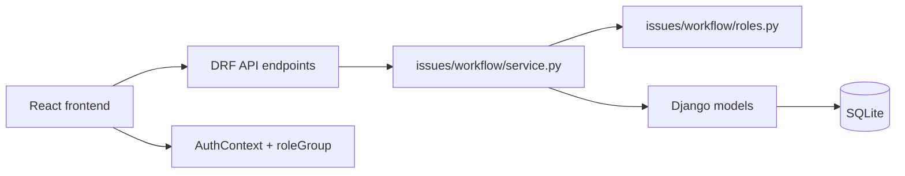

# Architecture Overview

This document reflects the current implementation in the repository as of the current branch state. It explicitly documents the architectural pivot from a generic student issue tracker to a workflow-driven academic routing system.

## 1. Current system architecture

The project is a Django backend plus a React/TypeScript frontend. The real authority for issue lifecycle decisions lives in the backend workflow engine, not in the frontend.

### Architectural layers

- Backend API layer: Django REST Framework viewsets/APIViews under `backend/issues`, `backend/accounts`, `backend/categories`, and `backend/departments`
- Business logic layer: workflow service, issue service, document service, and ML prediction entry points
- Domain layer: `Issue`, `IssueDocument`, `IssueActivity`, `Category`, `Department`, `UserProfile`, and related metadata
- Presentation layer: React frontend under `frontend/src` with route protection and role-aware dashboards

## 2. Backend app responsibilities

| App | Current responsibility |
| --- | --- |
| `accounts` | `UserProfile`, role constants, auth endpoints, staff directory, password-change flow |
| `issues` | issue creation, list/detail, workflow actions, document handling, status transition rules |
| `categories` | categories and required-document relationships |
| `departments` | department model and admin metadata; not the live routing authority |
| `documents_app` | document catalog entries used by issue documents |
| `ml` | ML classifier, model config, and prediction logic |
| `student_issue_system` | project-wide URL configuration |

## 3. Major architectural pivot

The repository has moved away from a simple generic issue tracker to a workflow-driven academic issue routing system.

The key distinction is:

- issue category: the type of issue, e.g. Missing Result, Grade Dispute, Portal/System Issue
- workflow definition: the role chain for a category, declared in `WORKFLOW_DEFINITIONS`
- starting role: the first role assigned for that category
- department-scoped roles: roles resolved against the student’s academic department (`UserProfile.department_name`)
- central roles: roles resolved institution-wide
- automatic assignment: done by the backend workflow engine
- workflow forwarding: done by the backend and validated against the category’s definition
- send-back behaviour: backend-defined transitions using `backward_transitions`
- final resolution authority: declared in `final_authority_roles`

The frontend is not the source of truth for workflow behaviour. The backend workflow engine decides issue routing, assignment, and approval authority.

## 4. Current role model

The actual backend role values are:

- `student`
- `course_adviser`
- `hod`
- `department_admin`
- `dept_exam_officer`
- `lecturer`
- `ict_officer`
- `exams_officer`
- `registry`
- `bursary`
- `school_admin_office`
- `student_affairs_officer`
- `admin`

The frontend collapses these into route groups:

- `student`
- `staff`
- `admin`

This route-level grouping is separate from the real backend `UserProfile.role` values used throughout the application.

## 5. Current workflow engine

The workflow engine in `backend/issues/workflow/service.py` is the single authority for issue moves such as:

- `perform_initial_assignment()`
- `start_review()`
- `forward_issue()`
- `send_back_issue()`
- `request_more_information()`
- `resolve_issue()`
- `confirm_resolution()`
- `reject_resolution()`
- `manual_assign_officer()`

The category-to-workflow mapping lives in `backend/issues/workflow/definitions.py`. The workflow definitions include:

| Category | Starting role | Fixed flow | Final authority |
| --- | --- | --- | --- |
| Missing Result | Course Adviser | Course Adviser → Department Admin → HOD → Exams Officer | Course Adviser, Exams Officer |
| Grade Dispute | Course Adviser | Course Adviser → Lecturer | Course Adviser |
| Course Registration | Course Adviser | Course Adviser → Exams Officer | Course Adviser |
| Transcript Request | Department Admin | Department Admin → HOD → Exams Officer | Exams Officer |
| School Fees Issue | Bursary | Bursary | Bursary |
| Academic Clearance | Department Admin | Department Admin → HOD | Department Admin |
| Admission Issue | School Admin Office | School Admin Office | School Admin Office |
| Certificate Collection | Registry | Registry → Bursary | Bursary |
| Examination Issue | Department Examination Officer | Department Examination Officer → HOD → Exams Officer | Department Examination Officer, Exams Officer |
| Portal/System Issue | ICT Officer | ICT Officer | ICT Officer |
| Student Welfare | Student Affairs Officer | Student Affairs Officer | Student Affairs Officer |
| Other | HOD | Dynamic | HOD |

The workflow engine also explicitly distinguishes department-scoped and central roles. Department-scoped roles are resolved against the issue owner’s own academic department; central roles are resolved institution-wide.

## 6. Issue statuses and lifecycle

The current status graph is fixed and explicitly enforced in `backend/issues/workflow/service.py`:

- `pending` → `ready_for_review`
- `ready_for_review` → `in_progress`
- `in_progress` → `ready_for_review` or `pending` or `resolved`
- `resolved` → `closed` or `pending`
- `closed` → no further ordinary workflow transitions

This is not a generic status model with free-form transitions; the backend rejects invalid transitions.

## 7. Document requirements and completeness

Category-level required documents are stored as a many-to-many relation from `Category` to `Document`.

When an issue is created, the issue service obtains the category’s required documents. The upload flow creates `IssueDocument` rows and recalculates completeness:

- missing documents list is built from required docs not yet uploaded
- `Issue.is_complete` is set to `True` only when the required list is fully satisfied
- if the issue was pending and is now complete, it is automatically moved to `ready_for_review`

This is implemented in `backend/issues/services/document_service.py` and is tied to `IssueActivity` entries for document uploads and review readiness.

## 8. Issue activity and audit trail

`IssueActivity` is a first-class model in `backend/issues/models.py` with fields for:

- issue reference
- action string
- performed_by user
- system-action flag
- notes
- timestamp

This is the project’s audit trail. It is used for actions such as issue creation, automatic assignment, manual assignment, review start, forwarding, send-back, resolution, and document uploads. System events are distinguished by `is_system_action=True`.

## 9. Authentication and user profiles

Authentication is Django-based, with a custom `UserProfile` model and custom serializers for login and staff creation.

Notable details:

- `UserProfile.role` is the real role field used throughout the app
- `UserProfile.department_name` is a free-text field used by current department-scoped role lookup
- `must_change_password` is stored on the profile and enforced by the frontend route guard
- the app login flow uses the email-based `EmailLoginView`, while the underlying SimpleJWT endpoints remain available in the project

## 10. Department architecture and routing reality

The `Department` model exists and has fields for:

- `name`
- `description`
- `kind` (`academic` or `administrative`)
- `assigned_officer`

However, the live workflow routing does not use `Department.assigned_officer` or `Category.department` to determine issue assignment. The route resolution is driven by `UserProfile.role` and the student’s department in `issues/workflow/roles.py`.

The department model is therefore not the source of truth for workflow routing. It is metadata and administrative structure, not the engine that chooses officers.

## 11. Frontend architecture

The frontend is a React application with the following current structure:

- `frontend/src/App.tsx`: top-level routes
- `frontend/src/routes/ProtectedRoute.tsx`: auth and role-group guard logic
- `frontend/src/components/layout/AppShell.tsx`: shell wrapper
- `frontend/src/components/layout/Sidebar.tsx`: role-group nav
- `frontend/src/components/layout/Topbar.tsx`: header/dashboard navigation
- `frontend/src/pages/student/Dashboard.tsx`: student-specific dashboard
- `frontend/src/pages/staff/Dashboard.tsx`: reusable staff dashboard
- `frontend/src/pages/admin/Dashboard.tsx`: admin overview dashboard
- `frontend/src/pages/reports/Reports.tsx`: shared charts and reports

The route groups are coarse-grained; the staff dashboard is still a single route but internally role-aware.

## 12. Role-aware staff dashboard design

The implemented staff dashboard redesign is a single component that reads the authenticated user’s actual role and then chooses role-specific, workflow-based workload information. It does not fabricate 11 separate dashboard screens.

The config used by the dashboard lives in:

- `frontend/src/lib/roleWorkloadConfig.ts`

This file is a frontend mirror of the workflow definitions and is used to determine:

- display title
- relevant categories for a role
- empty-state wording for the dashboard

The mirror is intentionally not the system’s backend source of truth. It must remain synchronized with `backend/issues/workflow/definitions.py` because there is no API endpoint that returns “categories by role” today.

## 13. Admin dashboard details

The admin dashboard currently contains a role coverage overview and an unassigned-by-role summary. It works by combining:

- `GET /api/issues/?unassigned=true`
- `GET /api/accounts/staff/directory/`
- the role/category mapping in `CATEGORY_STARTING_ROLE`

This is a presentation layer for workflow state. The backend still decides assignment and routing.

## 14. Backend/frontend data boundaries

The current split is:

- backend-owned: workflow route logic, assignment, authorization, issue status, issue activity, required-document logic
- frontend-owned: dashboard filtering, client-side aggregation, role-specific presentation, issue list filtering by current user

There is no dedicated backend dashboard aggregation API. The existing issue list endpoint is broad, and the dashboards derive their counts locally from that data. This is a practical current arrangement but it is not a high-scale analytics system.

## 15. ML classification status

The ML implementation is active in the creation flow:

- issue creation can call `predict_issue()`
- high-confidence predictions can create the issue immediately
- medium-confidence predictions ask for confirmation
- low-confidence predictions require manual selection

However, the repository does not currently persist classification confidence, prediction source, or outcome metadata onto the issue. That means ML metrics are not currently backed by stored data and should not be presented as implemented analytics.

## 16. Current scope and deferred work

### Implemented

- workflow-driven issue routing
- role-aware staff dashboard
- admin unassigned-by-role overview
- document completeness logic
- activity tracking

### Partially implemented

- department architecture still has a mismatch between the model and the actual workflow lookup mechanism
- some dashboard numbers are still derived client-side from broad issue data

### Deferred / not implemented

- dedicated categories-by-role API endpoint
- per-issue `can_resolve` serializer enhancement
- ML analytics dashboards backed by persisted prediction metadata
- 11 distinct staff dashboard components
- unnecessary backend dashboard aggregation endpoints for current front-end needs

## 17. Summary

The repository now reflects a functional workflow-driven academic issue system rather than a static generic issue tracker. The backend is the authority for routing and assignment; the frontend is a role-aware presentation layer over that backend system. Department and workflow architecture are real but they are not identical: the model contains a department structure, but the live issue-routing logic is driven by role definitions and the student’s department context, not by a direct department assignment chain.
